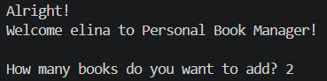
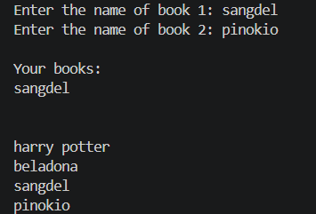
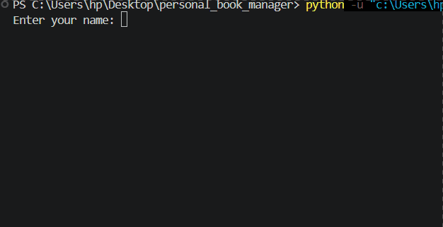

# Personal Book Manager


A simple book management project mode with Python

## Features 

- Add multiple books
- Display books 
- Save books
- Laod saved books
- Admin mood

## Project Structure
```
C:.
|   .env.example
│   .gitignore
│   main.py
│   README.md
│   requirements.txt
│   tasks.py
|   pic&gif/
```

## File Description

| file | description |
| --- | --- |
| `main.py` | runs the main program |
| `tasks.py` | contains functions for managing tasks |
| `requirements.txt` | lists the python packages required to run the project |
| `.gitignore` | specifies files and folders that git should ignore |
| `.env.example` | provides an example of the enviroment variables needed for the project |
| `README.md` | contains the project documentation |

## Requirements

- Python
- Python-dotenv

## Installation 

Install the required packages using:
```bash
Python -m pip install -r requirements.txt
```

## Environment Stup

Create a file named `.env` in the project folder.

You can use `env.example` as a template.

The required enviorment variable is:

`BOOK_MANAGER_ADMIN_PASSWORD`

Add following centent to your .env file:
```env
BOOK_MANAGER_ADMIN_PASSWORD=your_password_here
```
replace `your_password_here` with your own password.

## Run the project
```
main.py
```

## screenshots


  



 

## demo



## How it works
1. the program asks for the users name
2. It loads previously saved books
3. It displays the saved books
4. The user can add new books
5. The program displays all books
6. The books are saved for the next time
7. The user can enter Admin mood with the correct password

## Troubleshooting
### 1. File Not Found Error
* what does it mean?

`the program cannot find a required file`

* why can it happend?

`The file maybe missing or in the wrong folder`

* what should I check?

`check the file name and its location`

### 2. JSON code Error
* what does it mean?

`the program cannot read the JSON file correctly`

* why can it happend?

`The JSON file maybe empty or contain incorrect data`

* what should I check?

`check the content of books.json`

### 3. Modul Not Found Error
* what does it mean?

`Python can not find a required package`

* why can it happend?

`The` python-dotenv `package is maybe not be installed`

* what should I check?

`check if the package is installed`

### 4. Password Error
* what does it mean?

`The entered password doas not match the password in the` .env `file`

* why can it happend?

`the password or envoirment variable name maybe incorrect`

* what should I check?

`ccheck the ` .env `file and the variable name:` BOOK_MANAGER_ADMIN_PASSWORD